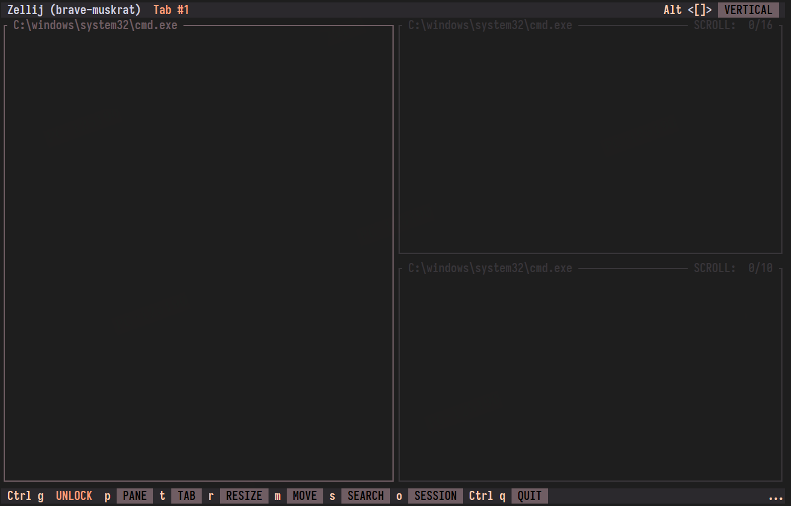
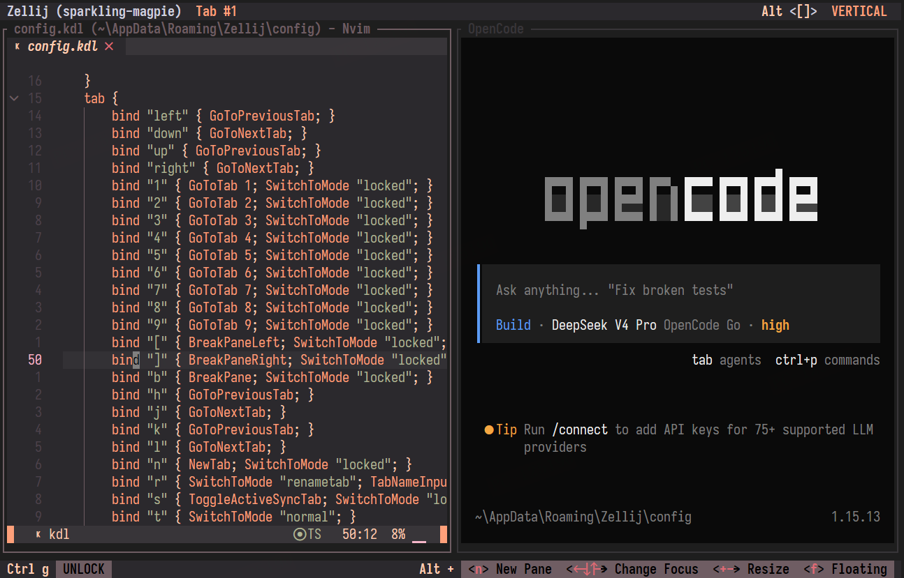

# Ferra port for Zellij

[Zellij](https://zellij.dev/) is a modern terminal multiplexer.

## Usage

Put `ferra.kdl` under your zellij config path `themes/` directory. i.e.

- Windows: `~/AppData/Roaming/Zellij/config/themes/`
- Mac/Linux: `~/.config/Zellij/config/themes/`

Then add this line into your zellij config file (`Zellij/config/config.kdl`):

```kdl
theme "ferra"
```

Done!

## Development

`generate_ferra.py` is a util script for generate this kdl file. Just have a peek and you'll get it. 

## Screenshots




